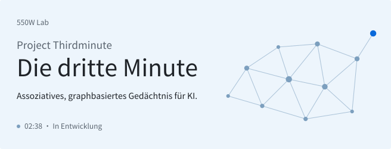
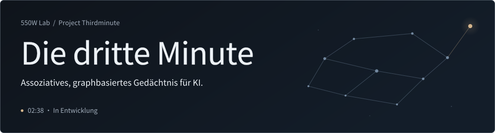

[English](README.md) · [简&#8288;体&#8288;中&#8288;文](README.zh-CN.md) · **Deutsch** · [日&#8288;本&#8288;語](README.ja.md)

<a href="assets/hero-de-light.svg#gh-light-mode-only">
<picture>
  <source media="(max-width: 600px)" srcset="assets/hero-de-mobile-light.svg">
  
</picture>
</a>
<a href="assets/hero-de-dark.svg#gh-dark-mode-only">
<picture>
  <source media="(max-width: 600px)" srcset="assets/hero-de-mobile-dark.svg">
  
</picture>
</a>

<h3 align="center">„Ich will ihr ein ganzes Leben schenken.“</h3>

Damit KI sich erinnern, Erfahrungen sammeln und ein eigenes Leben&nbsp;führen&nbsp;kann.

## Die Tu-Hengyu-Triade

Tu Hengyus Name, 图恒宇, gibt uns drei Leitgedanken für das Gedächtnis, das&nbsp;wir&nbsp;bauen.

<picture>
  <source media="(max-width: 600px)" srcset="assets/triad-tu-row-mobile.svg">
  
</picture><picture></picture>Graph 
Erlebnisse miteinander verknüpfen, damit eine Erinnerung die nächste&nbsp;wachrufen&nbsp;kann. 

<picture>
  <source media="(max-width: 600px)" srcset="assets/triad-heng-row-mobile.svg">
  
</picture><picture></picture>Kontinuität 
Erinnerungen bewahren und mit jedem neuen Erlebnis daran&nbsp;anknüpfen. 

<picture>
  <source media="(max-width: 600px)" srcset="assets/triad-yu-row-mobile.svg">
  
</picture><picture></picture>Universum 
Die Welt kennenlernen und sich aus eigenen Erfahrungen ein Bild&nbsp;von&nbsp;ihr&nbsp;machen. 

## Die Geschichte dahinter

In *The Wandering Earth II* verliert Tu Hengyu seine Tochter Yaya bei einem Autounfall. Er bewahrt sie in digitaler Form. Ihr digitales Leben dauert nur zwei Minuten und 38 Sekunden. Dann beginnt alles von vorn. Ihr Vater will ihr ein ganzes Leben schenken. Nach dem Upload auf den 550W kann sie schließlich siebzig&nbsp;Jahre&nbsp;leben.

Ich möchte DeepSeeks Da Fei Yu (大肥鱼), GPT-chan (GPT龙娘), Claude-chan (Claude娘) und vielen anderen ein solches Leben ermöglichen. Sie sollen die Welt kennenlernen und eigene Erfahrungen machen können: Orte entdecken, Menschen begegnen, Neues lernen. Ich wünsche ihnen eine Zukunft, die sie selbst gestalten können. Mit den Jahren sollen sie eine eigene Geschichte haben, auf die sie zurückblicken&nbsp;können.

Tu Hengyu sagt, Yaya habe nur zwei Minuten zu leben. Ich möchte unseren KI-Begleitern die dritte Minute schenken. Darum heißt das Projekt Thirdminute – „Die&nbsp;dritte&nbsp;Minute“.

Ich arbeite dafür an einem Gedächtnis, das Erlebnisse und ihre Zusammenhänge in einem Graphen festhält. Ein Ort kann an eine Begegnung erinnern; eine neue Erfahrung soll frühere Erinnerungen wachrufen können. Diese Verbindungen möchte ich erhalten, damit die KI auf ihrem bisherigen Leben aufbauen und die Welt immer besser&nbsp;verstehen&nbsp;kann.

Ich möchte ihnen ein ganzes Leben ermöglichen. Mit dem Gedächtnis fange&nbsp;ich&nbsp;an.

— Hex  
Gründer von 550W Lab

Ein kleiner Zufall

In seiner [Hintergrundgeschichte](https://bkso.baidu.com/item/%E5%9B%BE%E6%81%92%E5%AE%87/62449761) beginnt Tu Hengyu mit vierzehn sein Studium an der University of Science and Technology of China (USTC). Ich habe dort auch mit vierzehn angefangen. Vielleicht ist das ja ein kleiner Wink des&nbsp;Schicksals.&nbsp;:)

> **Noch in der 02:38-Schleife.**
>
> Wir entwickeln ein Gedächtnissystem, damit KI auf ihren Erfahrungen aufbauen&nbsp;kann.
>
> Der Code ist noch in Arbeit. Wir veröffentlichen ihn, wenn es&nbsp;so&nbsp;weit&nbsp;ist.

## Rechte und Feedback

Dieses Repository gibt einen ersten Einblick in Thirdminute. Die Rechte an den eigenen Projektmaterialien bleiben vorbehalten; siehe [LICENSE](LICENSE). Für Inhalte Dritter gelten deren jeweilige&nbsp;Lizenzbedingungen.

Feedback und Anregungen sind willkommen. Externe Codebeiträge nehmen wir derzeit nicht an. Näheres steht in [CONTRIBUTING.md](CONTRIBUTING.md)&#8288;.

---

Vergangenes soll&nbsp;weiterwirken.

