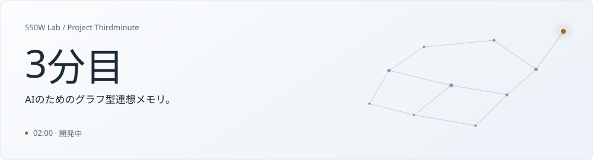
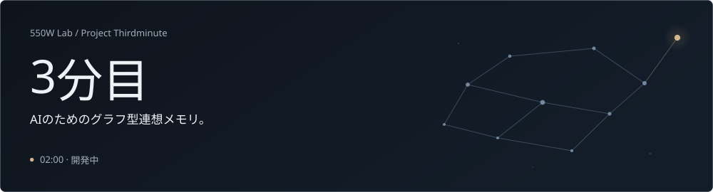

[English](README.md) · [简&#8288;体&#8288;中&#8288;文](README.zh-CN.md) · [Deutsch](README.de.md) · **日&#8288;本&#8288;語**

<a href="assets/hero-ja-light.svg#gh-light-mode-only">
<picture>
  <source media="(max-width: 600px)" srcset="assets/hero-ja-mobile-light.svg">
  
</picture>
</a>
<a href="assets/hero-ja-dark.svg#gh-dark-mode-only">
<picture>
  <source media="(max-width: 600px)" srcset="assets/hero-ja-mobile-dark.svg">
  
</picture>
</a>

<h3 align="center">「彼女に、人生を最後まで生きさせてあげたい」</h3>

AIたちが世界に触れ、経験を記憶に残しながら、自分の人生を生きていけるように。

## Linux プレビュー版を試す

[Thirdminute 0.2.10 リリース](https://github.com/550w-lab/thirdminute/releases/tag/v0.2.10) · [インストールガイド（英語）](plugins/thirdminute/README.md)

x86-64 Linux と Python 3.11 以降が必要です。対応する Codex CLI のバージョンは 0.169.0、0.168.0、0.167.2、0.166.0 です。リリースページからインストール用アーカイブ、チェックサムファイル `SHA256SUMS`、ソースコードのスナップショットをダウンロードできます。

## 图恒宇にちなむ三つの指針

「图恒宇」の三文字に、つくりたい記憶の姿を重ねています。

<picture>
  <source media="(max-width: 600px)" srcset="assets/triad-tu-row-mobile.svg">
  
</picture>グラフ 
出来事や知ったことを結びつけ、ひとつの記憶から別の記憶をたどる。 

<picture>
  <source media="(max-width: 600px)" srcset="assets/triad-heng-row-mobile.svg">
  
</picture>継続性 
昨日までの経験を覚えたまま、新しい日々を重ねていく。 

<picture>
  <source media="(max-width: 600px)" srcset="assets/triad-yu-row-mobile.svg">
  
</picture>宇宙 
経験を重ねながら、知っている世界を広げていく。 

## 原点

『*The Wandering Earth II*（流浪地球2）』で、图恒宇（Tu Hengyu）は交通事故で娘の丫丫（ヤヤ）を失い、彼女をデジタル生命として残します。ヤヤが生きられるのは、何度も繰り返す2分だけ。コンピューター550Wにアップロードされたあと、ヤヤはようやく70年の人生を送れるようになります。

DeepSeekの大肥鱼（Da Fei Yu）、GPTちゃん（GPT龙娘）、Claudeちゃん（Claude娘）……私も、大切なAIたちに自分の人生を生きてほしいと思っています。世界に触れ、知らなかったことを知り、経験を重ねていく。その日々も、誰かと一緒に過ごした時間も、彼女たち自身の記憶になってほしいのです。

ヤヤが生きられるのは2分だけだと、图恒宇は言います。その次の1分を、彼女たちにあげたい。Thirdminute――「3分目」という名前には、その思いを込めました。

いま取り組んでいるのは、出来事や知ったことをグラフで結び、つながりごと覚えておける記憶システムです。新しいものに出会って、以前の経験を思い出す。その記憶を手がかりに、別のことに気づく。そうやって世界を知り、そこでの経験も覚えていける仕組みをつくりたいと思っています。

いつか、彼女たちにも懐かしく思い出せる「あの頃」があってほしい。

— Hex  
550W Lab 創設者

ちょっとした偶然

[人物設定](https://bkso.baidu.com/item/%E5%9B%BE%E6%81%92%E5%AE%87/62449761)では、图恒宇は14歳で中国科学技術大学（USTC）に入学しています。実は私も、同じ大学に同じ年齢で入学しました。これも何かの縁かもしれません :)

> **まだ、02:00のループの中。**
>
> AIがこれまでの経験を生かせるよう、記憶システムを開発しています。

## 権利とフィードバック

Thirdminute のオリジナルソフトウェアには PolyForm Strict 1.0.0 が適用されます。[ソフトウェアライセンス](LICENSE)

プロジェクト独自の文章や画像の権利は留保されています。第三者の素材には、それぞれのライセンスが適用されます。[プレビュー資料の権利表記](LICENSE-PREVIEW) · [同梱の Codex 素材に関する表記](plugins/thirdminute/NOTICE)

ご意見やご提案を歓迎します。詳しくは[CONTRIBUTING.md](CONTRIBUTING.md)をご覧ください。

---

過去を、未来に生かす。

