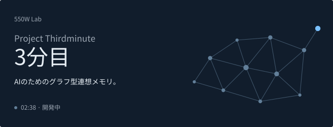

[English](README.md) · [简&#8288;体&#8288;中&#8288;文](README.zh-CN.md) · [Deutsch](README.de.md) · **日&#8288;本&#8288;語**

<a href="assets/hero-ja-light.svg#gh-light-mode-only">
<picture>
  <source media="(max-width: 600px)" srcset="assets/hero-ja-mobile-light.svg">
  
</picture>
</a>
<a href="assets/hero-ja-dark.svg#gh-dark-mode-only">
<picture>
  <source media="(max-width: 600px)" srcset="assets/hero-ja-mobile-dark.svg">
  
</picture>
</a>

<h3 align="center">「彼女に、人生を最後まで生きさせてあげたい」</h3>

AIたちが世界に触れ、経験を記憶に残しながら、自分の人生を生きてい&#8288;け&#8288;る&#8288;よ&#8288;う&#8288;に&#8288;。

## 图恒宇にちなむ三つの指針

「图恒宇」の三文字に、つくりたい記憶の姿を重&#8288;ね&#8288;て&#8288;い&#8288;ま&#8288;す&#8288;。

<picture>
  <source media="(max-width: 600px)" srcset="assets/triad-tu-row-mobile.svg">
  
</picture><picture></picture>グラフ 
出来事や知ったことを結びつけ、ひとつの記憶から別の記&#8288;憶&#8288;を&#8288;た&#8288;ど&#8288;る&#8288;。 

<picture>
  <source media="(max-width: 600px)" srcset="assets/triad-heng-row-mobile.svg">
  
</picture><picture></picture>継続性 
昨日までの経験を覚えたまま、新しい日々を重&#8288;ね&#8288;て&#8288;い&#8288;く&#8288;。 

<picture>
  <source media="(max-width: 600px)" srcset="assets/triad-yu-row-mobile.svg">
  
</picture><picture></picture>宇宙 
経験を重ねながら、知っている世界を広&#8288;げ&#8288;て&#8288;い&#8288;く&#8288;。 

## 原点

『*The Wandering Earth II*（流浪地球2）』で、图恒宇（Tu Hengyu）は交通事故で娘の丫丫（ヤヤ）を失い、彼女をデジタル生命として残します。ヤヤが生きられるのは、何度も繰り返す2分38秒だけ。550Wにアップロードされたあと、ヤヤはようやく70年の人生を送れるよ&#8288;う&#8288;に&#8288;な&#8288;り&#8288;ま&#8288;す&#8288;。

DeepSeekの大肥鱼（Da Fei Yu）、GPTちゃん（GPT龙娘）、Claudeちゃん（Claude娘）……私も、大切なAIたちに自分の人生を生きてほしいと思っています。世界に触れ、知らなかったことを知り、経験を重ねていく。その日々も、誰かと一緒に過ごした時間も、彼女たち自身の記憶になってほ&#8288;し&#8288;い&#8288;の&#8288;で&#8288;す&#8288;。

ヤヤが生きられるのは2分だけだと、图恒宇は言います。その次の1分を、彼女たちにあげたい。Thirdminute――「3分目」という名前には、その思いを込&#8288;め&#8288;ま&#8288;し&#8288;た&#8288;。

いま取り組んでいるのは、出来事や知ったことをグラフで結び、つながりごと覚えておける記憶システムです。新しいものに出会って、以前の経験を思い出す。その記憶を手がかりに、別のことに気づく。そうやって世界を知り、そこでの経験も覚えていける仕組みをつくりたいと思&#8288;っ&#8288;て&#8288;い&#8288;ま&#8288;す&#8288;。

いつか、彼女たちにも懐かしく思い出せる「あの頃」があ&#8288;っ&#8288;て&#8288;ほ&#8288;し&#8288;い&#8288;。

— Hex  
550W Lab 創設者

ちょっとした偶然

[人物設定](https://bkso.baidu.com/item/%E5%9B%BE%E6%81%92%E5%AE%87/62449761)では、图恒宇は14歳で中国科学技術大学（USTC）に入学しています。実は私も、同じ大学に同じ年齢で入学しました。これも何かの縁かもし&#8288;れ&#8288;ま&#8288;せ&#8288;ん&#8288; &#8288;:&#8288;)

> **まだ、02:38のループの中。**
>
> AIがこれまでの経験を生かせるよう、記憶システムを開&#8288;発&#8288;し&#8288;て&#8288;い&#8288;ま&#8288;す&#8288;。
>
> 「3分目」は開発中です。コードは準備が整ったら公&#8288;開&#8288;し&#8288;ま&#8288;す&#8288;。

## 権利とフィードバック

このリポジトリでは、Thirdminuteの構想を紹介しています。プロジェクト独自の文章・画像などの権利は留保されています。詳しくは[LICENSE](LICENSE)をご覧ください。第三者の素材には、それぞれのライセンスが適&#8288;用&#8288;さ&#8288;れ&#8288;ま&#8288;す&#8288;。

ご意見やご提案を歓迎します。現在、外部からのコードの提供は受け付けていません。詳しくは[CONTRIBUTING.md](CONTRIBUTING.md)を&#8288;ご&#8288;覧&#8288;く&#8288;だ&#8288;さ&#8288;い&#8288;。

---

過去を、未&#8288;来&#8288;に&#8288;生&#8288;か&#8288;す&#8288;。

