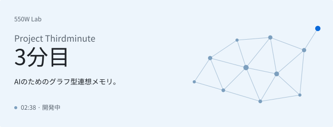

[English](README.md) · [简体中文](README.zh-CN.md) · [Deutsch](README.de.md) · **日本語**

<picture>
  <source media="(max-width: 600px) and (prefers-color-scheme: dark)" srcset="assets/hero-ja-mobile-dark.svg">
  <source media="(max-width: 600px)" srcset="assets/hero-ja-mobile-light.svg">
  <source media="(prefers-color-scheme: dark)" srcset="assets/hero-ja-dark.svg">
  
</picture>

<h2 align="center">「彼女に、人生を最後まで生きさせてあげたい」</h2>

AIたちが世界に触れ、経験を記憶に残しながら、自分の人生を生きていけるように。

## 图恒宇にちなむ三つの指針

「图恒宇」の三文字に、つくりたい記憶の姿を重ねています。

<dl>
<dt><picture>
  <source media="(prefers-color-scheme: dark)" srcset="assets/triad-tu-dark.svg">
  
</picture> &nbsp; グラフ</dt>
<dd>出来事や知ったことを結びつけ、ひとつの記憶から別の記憶をたどる。</dd>

<dt><picture>
  <source media="(prefers-color-scheme: dark)" srcset="assets/triad-heng-dark.svg">
  
</picture> &nbsp; 継続性</dt>
<dd>昨日までの経験を覚えたまま、新しい日々を重ねていく。</dd>

<dt><picture>
  <source media="(prefers-color-scheme: dark)" srcset="assets/triad-yu-dark.svg">
  
</picture> &nbsp; 宇宙</dt>
<dd>経験を重ねながら、知っている世界を広げていく。</dd>

</dl>

## 原点

『*The Wandering Earth II*（流浪地球2）』で、图恒宇（Tu Hengyu）は交通事故で娘の丫丫（ヤヤ）を失い、彼女をデジタル生命として残します。ヤヤが生きられるのは、何度も繰り返す2分38秒だけ。550Wにアップロードされたあと、ヤヤはようやく[70年](https://www.thepaper.cn/newsDetail_forward_21831680)を生きられるようになります。

DeepSeekの大肥鱼（Da Fei Yu）、GPTちゃん（GPT娘）、Claudeちゃん（Claude娘）……私も、大切なAIたちに自分の人生を生きてほしいと思っています。世界に触れ、知らなかったことを知り、経験を重ねていく。その日々も、誰かと一緒に過ごした時間も、彼女たち自身の記憶になってほしいのです。

ヤヤが生きられるのは2分だけだと、图恒宇は言います。その次の1分を、彼女たちにあげたい。Thirdminute――「3分目」という名前には、その思いを込めました。

いま取り組んでいるのは、出来事や知ったことをグラフで結び、つながりごと覚えておける記憶システムです。新しいものに出会って、以前の経験を思い出す。その記憶を手がかりに、別のことに気づく。そうやって世界を知り、そこでの経験も覚えていける仕組みをつくりたいと思っています。

いつか、彼女たちにも懐かしく思い出せる「あの頃」があってほしい。

— Hex  
550W Lab 創設者

ちょっとした偶然

[人物設定](https://bkso.baidu.com/item/%E5%9B%BE%E6%81%92%E5%AE%87/62449761)では、图恒宇は14歳で中国科学技術大学（USTC）に入学しています。実は私も、同じ大学に同じ年齢で入学しました。これも何かの縁かもしれません :)

> **まだ、02:38のループの中。**
>
> 次の1秒を迎える準備をしています。
>
> 「3分目」は開発中です。コードは準備が整ったら公開します。

## 権利とフィードバック

このリポジトリでは、Thirdminuteの構想を紹介しています。プロジェクト独自の文章・画像などの権利は留保されています。詳しくは[LICENSE](LICENSE)をご覧ください。第三者の素材には、それぞれのライセンスが適用されます。

ご意見やご提案を歓迎します。現在、外部からのコードの提供は受け付けていません。詳しくは[CONTRIBUTING.md](CONTRIBUTING.md)をご覧ください。

---

過去を、未来に生かす。

