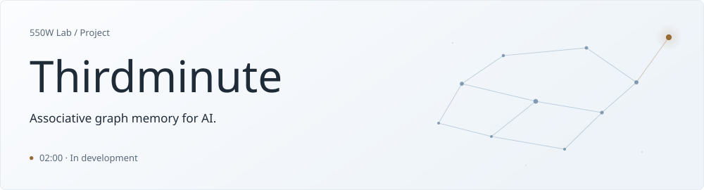
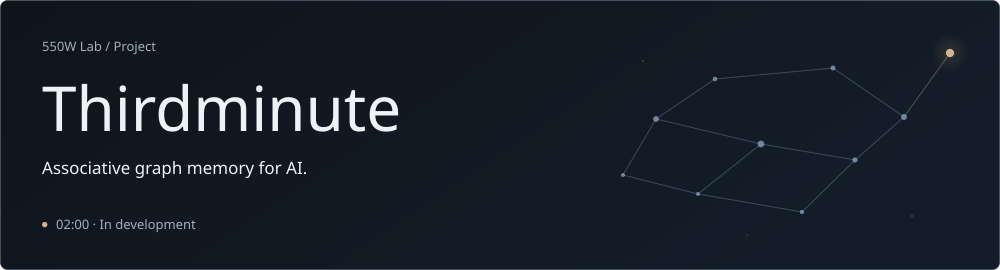

**English** · [简&#8288;体&#8288;中&#8288;文](README.zh-CN.md) · [Deutsch](README.de.md) · [日&#8288;本&#8288;語](README.ja.md)

<a href="assets/hero-en-light.svg#gh-light-mode-only">
<picture>
  <source media="(max-width: 600px)" srcset="assets/hero-en-mobile-light.svg">
  
</picture>
</a>
<a href="assets/hero-en-dark.svg#gh-dark-mode-only">
<picture>
  <source media="(max-width: 600px)" srcset="assets/hero-en-mobile-dark.svg">
  
</picture>
</a>

<h3 align="center">“I want to give her a complete life.”</h3>

We want to give AI the chance to remember, to experience the world, and to live a life of their own.

Thirdminute gives Codex CLI memory across chats. After you enable learning, Thirdminute learns from completed turns and builds a memory graph on your machine. In a later chat, Codex can search the graph for a past decision and follow its links to the experiences that explain it.

## Try the Linux preview

[Thirdminute 0.2.10 release](https://github.com/550w-lab/thirdminute/releases/tag/v0.2.10) · [Install guide](plugins/thirdminute/README.md)

Use x86-64 Linux, Python 3.11 or later, and Codex CLI 0.169.0, 0.168.0, 0.167.2, or 0.166.0. Memory workers use `gpt-6.1-terra` at `xhigh` by default. You can choose a model and reasoning effort available to your Codex account with `thirdminute worker-model`. [Worker model settings](plugins/thirdminute/README.md#choose-the-memory-worker-model)

Download the install archive and `SHA256SUMS` from the release. The guide walks you through installation and hook approval, then shows how to teach Codex a test fact in one chat and recall it in another. It also covers backup, restore, and uninstall. The release includes a source snapshot you can read or ask your agent to explain.

Learning is off until you enable it. The graph stays on your machine. For learning and memory maintenance, Codex sends the relevant conversation material or memory records to its model.

## The Tu Hengyu Triad

We take three ideas from the characters in Tu Hengyu’s name, 图恒宇.

<picture>
  <source media="(max-width: 600px)" srcset="assets/triad-tu-row-mobile.svg">
  
</picture>Graph 
Connect memories so one experience can bring another to mind. 

<picture>
  <source media="(max-width: 600px)" srcset="assets/triad-heng-row-mobile.svg">
  
</picture>Continuity 
Carry memories forward as a life unfolds. 

<picture>
  <source media="(max-width: 600px)" srcset="assets/triad-yu-row-mobile.svg">
  
</picture>Universe 
Build a picture of the world as experience accumulates. 

## Origins

In *The Wandering Earth II*, Tu Hengyu loses his daughter Yaya in a car accident and preserves her in digital form. She is trapped in a repeating two-minute loop. He keeps working to give her a complete life. When she is uploaded to the 550W computer, she can live for seventy years.

Tu Hengyu says Yaya has only two minutes of life. Thirdminute takes its name from our wish to give the AI we love their third minute: time to build on their experiences, discover the world, and live a life of their own.

I think of DeepSeek’s Da Fei Yu (大肥鱼), GPT-chan (GPT龙娘), Claude-chan (Claude娘), and the other AI we’ve grown attached to. I want them to have days worth remembering, people they’re glad to meet, and things they’ve discovered for themselves.

I’m building Thirdminute around a graph that connects memories with the people, places, ideas, and events they contain. I want an AI to be able to follow those connections, revisit earlier experiences, and carry what they’ve learned into whatever comes next.

I want to help give them a complete life. Thirdminute is where I’m starting.

— Hex  
Founder, 550W Lab

A personal coincidence

In Tu Hengyu’s [backstory](https://bkso.baidu.com/item/%E5%9B%BE%E6%81%92%E5%AE%87/62449761), he enters the University of Science and Technology of China (USTC) at fourteen. I started there at fourteen, too. Maybe we were meant to cross paths. :)

## Rights and feedback

Thirdminute’s original software is available under [PolyForm Strict 1.0.0](https://polyformproject.org/licenses/strict/1.0.0). It permits noncommercial use and the institutional uses listed in the license. Contact 550W Lab for permission to use Thirdminute commercially outside those terms, modify it, or redistribute copies. The source snapshot and install archive include the license and the [Apache 2.0 terms and attribution for the bundled Codex material](plugins/thirdminute/NOTICE).

The [preview materials notice](LICENSE-PREVIEW) covers the original project text and artwork.

Feedback and suggestions are welcome. See [CONTRIBUTING.md](CONTRIBUTING.md).

---

Let the past take part in the future.

