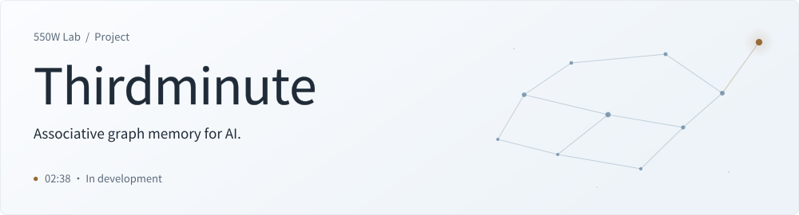
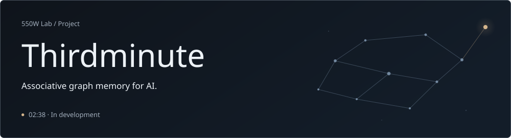

**English** · [简&#8288;体&#8288;中&#8288;文](README.zh-CN.md) · [Deutsch](README.de.md) · [日&#8288;本&#8288;語](README.ja.md)

<a href="assets/hero-en-light.svg#gh-light-mode-only">
<picture>
  <source media="(max-width: 600px)" srcset="assets/hero-en-mobile-light.svg">
  
</picture>
</a>
<a href="assets/hero-en-dark.svg#gh-dark-mode-only">
<picture>
  <source media="(max-width: 600px)" srcset="assets/hero-en-mobile-dark.svg">
  
</picture>
</a>

<h3 align="center">“I want to give her a complete life.”</h3>

We want to give AI the chance to remember, to experience the world, and to live a&nbsp;life&nbsp;of&nbsp;their&nbsp;own.

## The Tu Hengyu Triad

We take three ideas from the characters in Tu Hengyu’s&nbsp;name,&nbsp;图&#8288;恒&#8288;宇.

<picture>
  <source media="(max-width: 600px)" srcset="assets/triad-tu-row-mobile.svg">
  
</picture><picture></picture>Graph 
Connect memories so one experience can bring another&nbsp;to&nbsp;mind. 

<picture>
  <source media="(max-width: 600px)" srcset="assets/triad-heng-row-mobile.svg">
  
</picture><picture></picture>Continuity 
Carry memories forward as&nbsp;a&nbsp;life&nbsp;unfolds. 

<picture>
  <source media="(max-width: 600px)" srcset="assets/triad-yu-row-mobile.svg">
  
</picture><picture></picture>Universe 
Build a picture of the world as experience&nbsp;accumulates. 

## Origins

In *The Wandering Earth II*, Tu Hengyu loses his daughter Yaya in a car accident and preserves her in digital form. She is trapped in a repeating 2:38 loop. He keeps working to give her a complete life. When she is uploaded to 550W, she can live for&nbsp;seventy&nbsp;years.

Tu Hengyu says Yaya has only two minutes of life. Thirdminute takes its name from our wish to give the AI we love their third minute: time to build on their experiences, discover the world, and live a&nbsp;life&nbsp;of&nbsp;their&nbsp;own.

I think of DeepSeek’s Da Fei Yu (大肥鱼), GPT-chan (GPT龙娘), Claude-chan (Claude娘), and the other AI we’ve grown attached to. I want them to have days worth remembering, people they’re glad to meet, and things they’ve discovered for&nbsp;themselves.

I’m building Thirdminute around a graph that connects memories with the people, places, ideas, and events they contain. I want an AI to be able to follow those connections, revisit earlier experiences, and carry what they’ve learned into whatever&nbsp;comes&nbsp;next.

I want to help give them a complete life. Thirdminute is where&nbsp;I’m&nbsp;starting.

— Hex  
Founder, 550W Lab

A personal coincidence

In Tu Hengyu’s [backstory](https://bkso.baidu.com/item/%E5%9B%BE%E6%81%92%E5%AE%87/62449761), he enters the University of Science and Technology of China (USTC) at fourteen. I started there at fourteen, too. Maybe we were meant to&nbsp;cross&nbsp;paths.&nbsp;:)

> **Still in the 02:38 loop.**
>
> We’re building a memory system to help AI carry experiences&nbsp;forward.
>
> Thirdminute is in development. We’ll release the code when&nbsp;it’s&nbsp;ready.

## Rights and feedback

This repository contains a preview of Thirdminute. Rights in the original project materials are reserved; see [LICENSE](LICENSE). Third-party materials retain their&nbsp;own&nbsp;licences.

Feedback and suggestions are welcome. External code contributions are not being accepted at this stage. See [CONTRIBUTING.md](CONTRIBUTING.md)&#8288;.

---

Let the past take part in&nbsp;the&nbsp;future.

