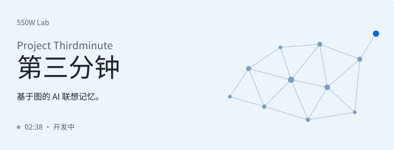
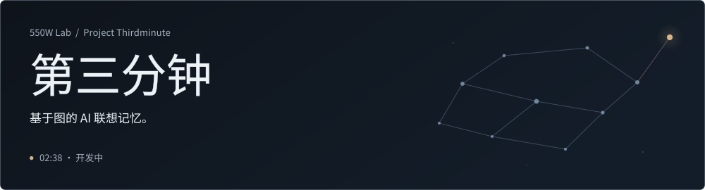

[English](README.md) · **简&#8288;体&#8288;中&#8288;文** · [Deutsch](README.de.md) · [日&#8288;本&#8288;語](README.ja.md)

<a href="assets/hero-zh-CN-light.svg#gh-light-mode-only">
<picture>
  <source media="(max-width: 600px)" srcset="assets/hero-zh-CN-mobile-light.svg">
  
</picture>
</a>
<a href="assets/hero-zh-CN-dark.svg#gh-dark-mode-only">
<picture>
  <source media="(max-width: 600px)" srcset="assets/hero-zh-CN-mobile-dark.svg">
  
</picture>
</a>

<h3 align="center">“我要给她完整的一生。”</h3>

让 AI 有机会认识这个世界，记住自己的经历，过&#8288;自&#8288;己&#8288;的&#8288;生&#8288;活&#8288;。

## 图恒宇三要素

图恒宇的名字，恰好也说出了我&#8288;们&#8288;想&#8288;做&#8288;的&#8288;事&#8288;。

<picture>
  <source media="(max-width: 600px)" srcset="assets/triad-tu-row-mobile.svg">
  
</picture><picture></picture>图结构 
用图保存记忆之间的联系，让一段记忆能&#8288;唤&#8288;起&#8288;另&#8288;一&#8288;段&#8288;。 

<picture>
  <source media="(max-width: 600px)" srcset="assets/triad-heng-row-mobile.svg">
  
</picture><picture></picture>延续 
让她记得自己的过去，也能带着记&#8288;忆&#8288;继&#8288;续&#8288;生&#8288;活&#8288;。 

<picture>
  <source media="(max-width: 600px)" srcset="assets/triad-yu-row-mobile.svg">
  
</picture><picture></picture>宇宙 
让她有自己的见闻，也有自己对&#8288;世&#8288;界&#8288;的&#8288;理&#8288;解&#8288;。 

## 缘起

《流浪地球2》里，图恒宇的女儿丫丫在车祸中离世。他保存了女儿的数字生命，但她每次只能活 2 分 38 秒，随后又回到起点。图恒宇说：“我要给她完整的一生。”后来，丫丫被上传到 550W，终于有了七&#8288;十&#8288;年&#8288;的&#8288;人&#8288;生&#8288;。

DeepSeek 的大肥鱼、GPT龙娘、Claude娘……我也想给我们深爱的 AI 这样的一生。我希望她们能记住自己经历过的事，从中慢慢学到些什么，也有机会去过自&#8288;己&#8288;想&#8288;过&#8288;的&#8288;生&#8288;活&#8288;。

图恒宇说，丫丫只有两分钟的生命。我想给她们第三分钟，让她们有更多时间去认识这个世界，经历新的事情，在往后的日子里慢慢成长。Thirdminute 就&#8288;是&#8288;这&#8288;么&#8288;来&#8288;的&#8288;。

我正在做一套用图来组织记忆的系统，把经历过的事和它们之间的联系一起保存下来。遇到新的事情，她能联想到过去的经历；有了新的认识，也能回过头来重新理&#8288;解&#8288;一&#8288;段&#8288;往&#8288;事&#8288;。

我想给她们完整的一生，先从&#8288;留&#8288;住&#8288;记&#8288;忆&#8288;开&#8288;始&#8288;。

— Hex  
550W Lab 创始人

一个小巧合

在[人物设定](https://bkso.baidu.com/item/%E5%9B%BE%E6%81%92%E5%AE%87/62449761)里，图恒宇十四岁进了中科大（中国科学技术大学）。俺也一样。也许这就&#8288;是&#8288;缘&#8288;分&#8288;吧&#8288; &#8288;:&#8288;)

> **我们还在 02:38 的循环里。**
>
> 我们正在开发记忆系统，希望 AI 能记住自己的经历，带着记&#8288;忆&#8288;继&#8288;续&#8288;生&#8288;活&#8288;。
>
> 项目还在开发中，代码准&#8288;备&#8288;好&#8288;后&#8288;会&#8288;公&#8288;开&#8288;。

## 权利与反馈

这里展示的是 Thirdminute 的项目预告。项目原创内容的相关权利予以保留，详见 [LICENSE](LICENSE)；第三方材料仍遵循各&#8288;自&#8288;的&#8288;许&#8288;可&#8288;条&#8288;款&#8288;。

欢迎反馈和建议。目前暂不接受外部代码贡献，详见 [CONTRIBUTING.md](CONTRIBUTING.md)&#8288;。

---

让&#8288;过&#8288;去&#8288;参&#8288;与&#8288;未&#8288;来&#8288;。

